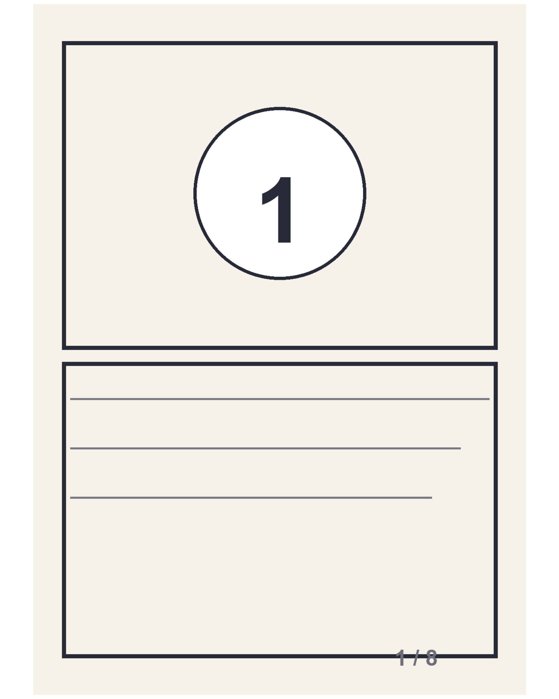
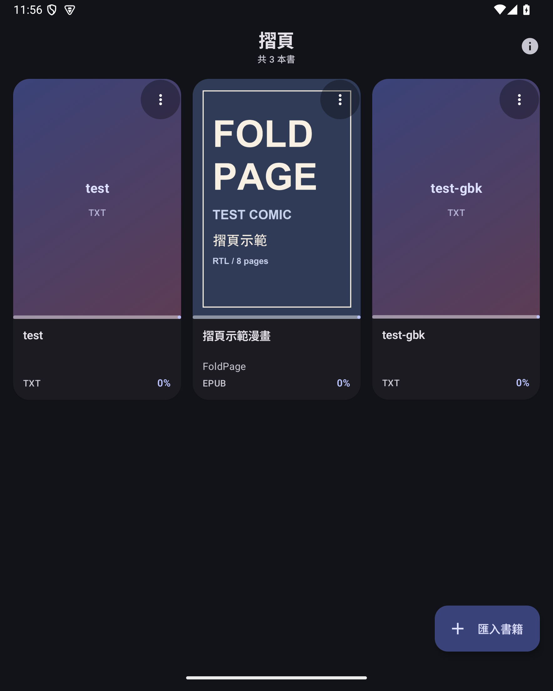

# 摺頁 FoldPage 0.1.0

為漫畫而做的 **EPUB / TXT 閱讀器（Android）**。直向顯示完整一頁；橫向或展開摺疊屏時，自動左右並排兩頁，不足的地方用白色填充。UI 採用 Google Material 3（動態色彩、edge-to-edge），閱讀時沉浸全螢幕。

> 這是 Android 第一版。iOS（iPhone 摺疊機）尚未開始，但解析、分頁與 UI 已分層，之後可共用同一套閱讀核心。

## 下載

| 項目 | 位置 |
| --- | --- |
| APK | [`dist/FoldPage-0.1.0.apk`](dist/FoldPage-0.1.0.apk)（約 6.3 MB） |
| SHA-256 | [`dist/FoldPage-0.1.0.apk.sha256`](dist/FoldPage-0.1.0.apk.sha256) |
| 安裝步驟 | [`安裝說明.md`](安裝說明.md) |
| 示範檔 | [`samples/`](samples/)（漫畫 EPUB、文字 EPUB、TXT） |

SHA-256：

```text
b3f0c7770d84392d7fa3aa044f04dbe5c338a4f963e8eb0eb5fef0dfd467fa14
```

- 套件：`com.kanae.foldpage`
- 版本：`0.1.0`（versionCode 1）
- 最低系統：Android 8.0（API 26）；目標 API 35
- 簽章：本機自簽（更新時請保留同一把 keystore，見 `signing/`）

## 已完成的功能

### 書庫
- 以系統檔案選擇器匯入 `.epub` / `.txt`；檔案會複製到 App 私人空間，之後完全離線。
- 書庫自動抓 EPUB 封面；文字書若無封面，顯示材質色佔位卡。
- 顯示閱讀進度、最近閱讀排序、深色模式。
- 長按卡片右上角選單：繼續閱讀、從第一頁重新開始、從書庫移除（有確認，原始檔案不受影響）。
- 空白書庫有引導頁；匯入／刪除／錯誤都有 Snackbar 或進度遮罩。

### 漫畫 EPUB
- 解析 EPUB 2/3：`container.xml → OPF → spine`。
- 支援「spine 直接是圖片」與「XHTML 內包一張圖」兩種常見漫畫封裝。
- 抓取 `cover-image`／`meta name="cover"`／guide cover 作封面。
- 圖像頁直接從 zip 解碼，使用縮放與 LruCache（最多 96 MB），不一次解壓整本。
- 內建 EPUB 的 `page-progression-direction="rtl"` 會自動套用；也可手動改成右至左／左至右。

### 文字（EPUB 文字書／TXT）
- TXT 自動辨識 UTF-8（含 BOM）、UTF-16 BOM、GB18030/GBK；實測 GBK 中文正常。
- 自動以「第 X 章／回／節／卷…」、`Chapter N` 等行切章；章名以粗體標題呈現。
- 用 Android 文字排版引擎逐行分頁，字級 14–30 sp 可調；調整後自動重排並保留目前位置。
- 章節從新頁開始；翻頁以字元位置儲存，換字級、旋轉、摺疊都不會迷路。

### 摺疊屏／視窗自適應
- 判斷規則（`DualMode.AUTO`）：
  - **直向**：單頁，完整一頁置中，白底留白。
  - **橫向／內屏展開且寬度 ≥ 600dp、高度 ≥ 480dp**：左右各一頁。
  - 外屏或窄視窗（高度 < 480dp 的橫向手機）維持單頁，避免兩頁被壓得過小。
- 內屏雙頁時，RTL 漫畫會自動把第一頁放在右邊、第二頁放左邊。
- Activity 處理 `orientation|screenSize|smallestScreenSize|screenLayout|density|fontScale|uiMode` 等設定變化，不重建、不丟頁；文字會依新欄寬重新分頁。
- 實測 7.6 吋摺疊屏模擬器（1768×2208 @ 420dpi），以及模擬外屏 1080×2400。

### 閱讀操作
- 手指左右滑動：翻頁（一般 Pager 滑動動畫）。
- 點螢幕**左側 30%**／**右側 30%**：上一頁／下一頁；RTL 模式左右語意自動互換。
- 點**中間 40%**：顯示／隱藏工具列（6 秒自動隱藏）。
- 工具列：返回、書名、頁碼、設定、頁碼滑桿、上／下一頁。
- 閱讀時強制白底（依需求「留白用白色填充」），書庫與設定則跟隨系統深色／動態色彩。
- 螢幕保持開啟；離開閱讀器時自動儲存進度。

## 畫面

| 書庫 | 直向：完整一頁 |
| --- | --- |
|  |  |

| 橫向／內屏：左右兩頁 | 文字雙頁 |
| --- | --- |
|  |  |

| 文字直向 | 閱讀設定 |
| --- | --- |
|  |  |

| 深色書庫 | 空白書庫 |
| --- | --- |
|  |  |

## 專案結構

```text
foldpage/
├── app/src/main/java/com/kanae/foldpage/
│   ├── format/      EPUB 解析、TXT 編碼偵測與切章
│   ├── reader/      EPUB 圖像解碼快取、文字分頁器
│   ├── data/        書庫 JSON、進度、閱讀設定
│   ├── ui/          書庫、閱讀器、設定（Jetpack Compose + Material 3）
│   └── MainActivity.kt
├── app/src/debug/   測試用匯入 Activity（不進 release APK）
├── samples/         示範 EPUB/TXT
├── docs/screenshots/
├── signing/         本機自簽 keystore
└── dist/            已簽章 APK
```

- 只用 AndroidX + Jetpack Compose + Material 3，沒有 Room、Coil、第三方 EPUB 函式庫。
- 書庫資料：`files/foldpage/library.json`；書籍：`files/foldpage/books/`；封面：`files/foldpage/covers/`。

## 建置

需求：JDK 17、Android SDK 35（build-tools 35）、Gradle 8.9。本工作區已附工具鏈於 `../.tools/`。

```bash
cd foldpage
export JAVA_HOME="/Users/kanae/Documents/DSH/.tools/jdk/Contents/Home"
export ANDROID_HOME="/Users/kanae/Documents/DSH/.tools/sdk"
export GRADLE_USER_HOME="/Users/kanae/Documents/DSH/.tools/gradle-home"
../.tools/gradle/gradle-8.9/bin/gradle assembleRelease
```

產物：`app/build/outputs/apk/release/app-release.apk`。

`signing/foldpage-release.keystore` 是這版的自簽憑證（密碼寫在 `app/build.gradle`，僅供本機測試）。若要上架或長期更新，請換成自己的 keystore 並妥善保管；換 key 會導致無法覆蓋安裝舊版。

## 已知限制（V1 刻意未做）

- **不支援 DRM／加密 EPUB**；遇到會顯示無法解析。
- 不支援 CBZ/CBR/PDF/漫畫圖片資料夾；只收 EPUB 與 TXT。
- 沒有雙指縮放、雙擊放大、頁面裁切／去白邊、跨頁對齊。目前是「整頁 Fit + 白底留白」。
- 文字 EPUB 中的插圖不會顯示；圖文混合的 EPUB 會依 spine 多數類型選一種模式（多為圖像）。
- 沒有書籤、註解、搜尋、目錄跳轉、TTS。
- 漫畫雙頁以 (1,2)、(3,4)… 配對，第一頁封面不一定單獨顯示。
- 進度百分比以頁數／字元數估算；超長文字書第一次排版可能需要數秒（背景執行，非同步）。
- 尚未在實機小米 18 Fold 上驗證；目前證據全部來自 Android 15 摺疊屏模擬器與外屏尺寸模擬。
- 只做 Android；iOS 尚未開始。

## 驗證紀錄（2026-10-22）

環境：Android 15（API 35）arm64 模擬器，7.6 吋摺疊屏，1768×2208 @ 420dpi。

已完成：

- clean 建置 release APK；`apksigner verify` 通過；manifest 不含 debug 測試 Activity。
- 全新安裝 → 空白書庫 → 用系統 SAF 選檔匯入 EPUB → 書庫 4 本書（含重複測試）→ 刪除確認 → 回到 3 本。
- 漫畫 EPUB：封面、直向完整單頁、橫向左右雙頁、RTL 左右順序、點左右翻頁、頁碼滑桿。
- 文字 EPUB：章名不重複、章節分頁、直向／橫向雙頁。
- TXT：UTF-8 與 GBK 中文、章節切分、字級 18→28→18、重排與位置保留。
- 旋轉／摺疊尺寸切換（1768×2208 ↔ 1080×2400 ↔ 2400×1080）不崩潰；外屏橫向維持單頁。
- 深色模式書庫與狀態列圖示對比。
- 進度保存：漫畫 25%、文字 EPUB 71% 回到書庫後仍正確。
- logcat crash buffer 無紀錄。

未驗證：實機、超大檔案（>100 MB）、DRM、圖文混合 EPUB、無障礙朗讀器實測。

## 下一步（建議）

1. 在實機小米 18 Fold 校準展開/折疊時的行為與鉸鏈區。
2. 加入雙指縮放、雙擊放大、頁面裁切與跨頁對齊。
3. 目錄（EPUB nav/NCX）、書籤、跳頁輸入。
4. CBZ/CBR 支援（與 EPUB 共用頁面模型即可）。
5. iOS：把 `format/` 與文字分頁邏輯抽成 Kotlin Multiplatform，UI 用 Compose Multiplatform 或 SwiftUI 重寫；摺疊適配改用 iOS size class／`UISplitViewController` 概念。尚未動工。

## 授權

個人專案，未指定開源授權。示範檔案為本專案自行生成，可自由測試使用。
