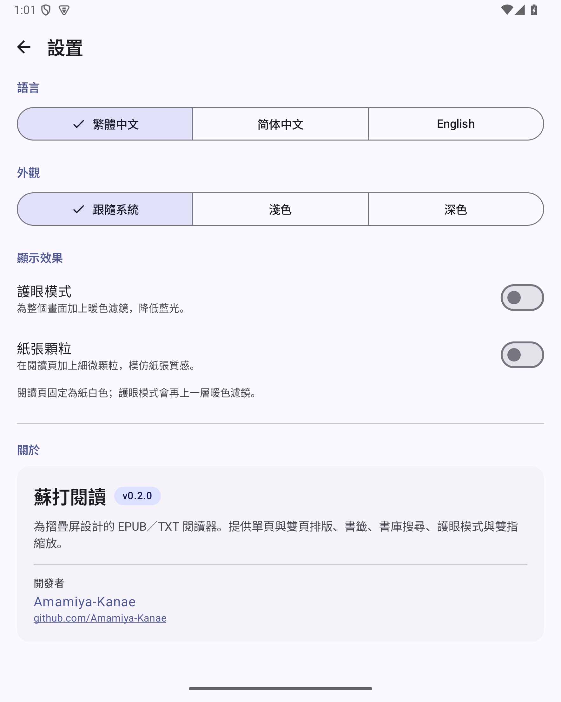
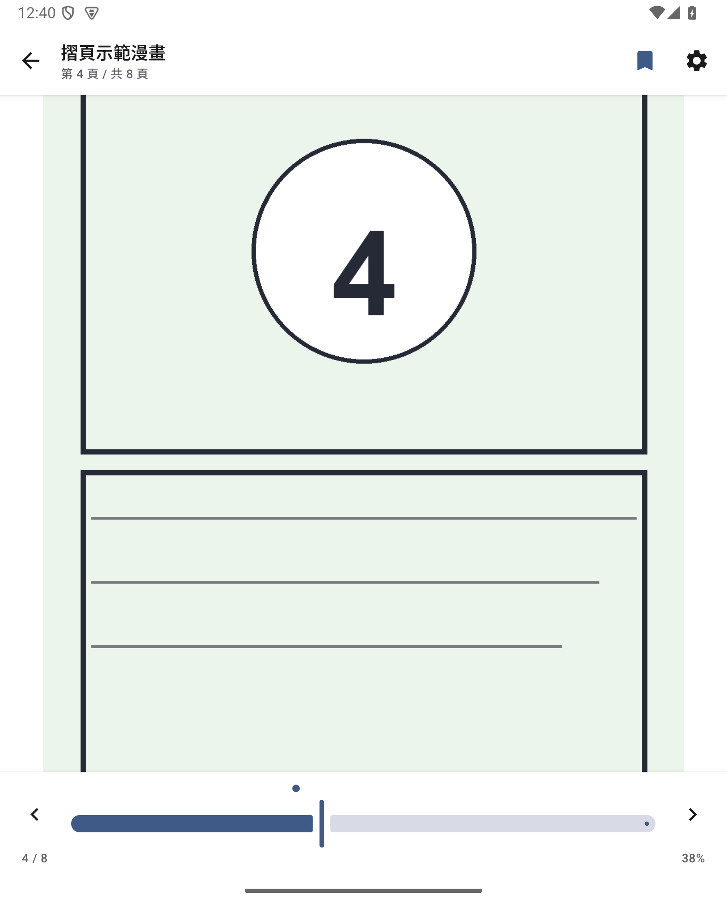

# 蘇打閱讀 Soreada 0.2.0


為漫畫與文字而做的 **EPUB / TXT 閱讀器（Android）**。直向顯示完整一頁；橫向或展開摺疊屏時，左右並排兩頁，留白以白色填充。介面採用 Google Material 3，支援繁體中文、简体中文與 English。

> 專案原名 FoldPage／摺頁。名稱已改為 **蘇打閱讀 Soreada**；Android package 仍保留 `com.kanae.foldpage`，方便直接覆蓋更新舊版，書庫與進度不會消失。若之後要正式發佈，可在上架前再改 package。

## 下載

| 項目 | 位置 |
| --- | --- |
| APK | [`dist/Soreada-0.2.0.apk`](dist/Soreada-0.2.0.apk)（約 6.3 MB） |
| SHA-256 | [`dist/Soreada-0.2.0.apk.sha256`](dist/Soreada-0.2.0.apk.sha256) |
| 安裝說明 | [`安裝說明.md`](安裝說明.md) |
| 示範檔 | [`samples/`](samples/)（漫畫 EPUB、文字 EPUB、TXT） |

```text
224ab6cca7efa8ce96b404b51aa2e74219d7008fbfe36a2c649e08b310f443ac
```

- 套件：`com.kanae.foldpage`
- 版本：`0.2.0`（versionCode 2）
- 最低系統：Android 8.0（API 26）；目標 API 35
- 簽章：本機自簽（更新時請保留 `signing/` 內的 keystore）

## 0.2.0 新增

- **新圖標**：打開的書配上上升的蘇打氣泡，薄荷綠、珊瑚與深海綠色，符合 Material 3 的簡潔風格。

- **護眼模式**：整個畫面加上暖色濾鏡，降低藍光；可調 0–100% 強度，書庫、設定、閱讀頁都有效。
- **紙張顆粒**：閱讀頁加上細微黑白顆粒，模仿紙張質感；可調 0–100% 強度，只套用在閱讀頁。
- **雙指縮放**：漫畫頁支援 1×–4× 雙指縮放與放大後單指拖動；縮放期間暫停左右翻頁，換頁或換版面會自動還原。文字頁不使用縮放，維持分頁閱讀。
- **預設翻頁方向改為左至右**：舊版 `AUTO` 設定會一次性遷移為 LTR；仍可在閱讀設定選「自動／左至右／右至左」。
- **全局設置**：書庫右上角齒輪進入，包含語言、外觀、顯示效果、關於。
  - 語言：繁體中文／简体中文／English，立即切換、不用重開。
  - 外觀：跟隨系統／淺色／深色（手動切換）。
  - 顯示效果：護眼模式、紙張顆粒與強度。
- **書籤**：每本書可加多個書籤；閱讀器右上角書籤按鈕加入／移除，進度條上方顯示書籤圓點，點圓點直接跳到該頁。文字書以「字元位置」儲存，換字級、旋轉、摺疊後仍能回到同一段。
- **書庫搜尋**：按書名或作者即時過濾，附無結果提示。
- **品牌更新**：App 名稱改為「蘇打閱讀／Soreada」，啟動畫面、關於頁與文件同步更新。

## 既有功能

- **書庫**：SAF 匯入 `.epub` / `.txt`，自動抓封面、閱讀進度、最近閱讀排序、深色模式、空白引導頁；可繼續閱讀、從第一頁重新開始、移除（含確認）。
- **漫畫 EPUB**：EPUB 2/3 spine 解析，支援「spine 直接是圖片」與「XHTML 包一張圖」；封面抓取；圖片直接從 zip 解碼並用 LruCache。
- **文字書**：TXT 自動辨識 UTF-8／UTF-16／GB18030（GBK 已實測），EPUB 文字章節；章名粗體、章節新頁、14–30sp 字級、重排保留位置。
- **摺疊屏自適應**：直向單頁；橫向且寬 ≥ 600dp、高 ≥ 480dp 時雙頁；外屏／窄視窗維持單頁。旋轉、展開、摺疊都會重新排版並保留位置。
- **操作**：左右滑動翻頁；點左／右 30% 翻頁（RTL 自動左右互換）；點中間顯示工具列（6 秒自動隱藏）；頁碼滑桿、上／下一頁、沉浸全螢幕。
- **Material 3**：動態色彩、edge-to-edge、狀態列圖示對比、載入／空白／錯誤／刪除確認狀態。
- 完全離線，無網路權限。

## 畫面

| 書庫 | 全局設置 |
| --- | --- |
|  |  |

| 閱讀設定 | 書籤（進度條圓點） |
| --- | --- |
|  |  |

| 護眼模式 | 內屏橫向：左至右雙頁 |
| --- | --- |
|  |  |


## 操作速查

| 操作 | 功能 |
| --- | --- |
| 左右滑動 | 翻頁 |
| 點左／右側 30% | 上一頁／下一頁（RTL 時左右互換；縮放中只切換工具列） |
| 點中間 | 顯示／隱藏工具列 |
| 雙指張開／收合 | 漫畫頁放大／縮小（1×–4×） |
| 放大後單指拖動 | 平移頁面 |
| 右上書籤圖示 | 加入／移除目前頁書籤 |
| 進度條上方圓點 | 點擊跳到該書籤 |
| 齒輪（書庫） | 全局設置：語言、主題、護眼、顆粒 |
| 齒輪（閱讀器） | 閱讀方向、單／雙頁、字級、護眼、顆粒 |
| 放大鏡（書庫） | 搜尋書名／作者 |

## 專案結構

```text
app/src/main/java/com/kanae/foldpage/
├── format/      EPUB 解析、TXT 編碼偵測與切章、錯誤種類
├── reader/      EPUB 圖像解碼快取、文字分頁器
├── data/        書庫 JSON、進度、書籤、閱讀設定、App 設定
├── ui/          書庫、閱讀器、全局設置、i18n、縮放／顆粒元件
│   └── theme/   Material 3 主題與手動深色模式
└── SoreadaApplication.kt
```

- 只用 AndroidX + Jetpack Compose + Material 3，沒有 Room、Coil、第三方 EPUB 函式庫。
- 書庫資料：`files/foldpage/library.json`；書籍：`files/foldpage/books/`；封面：`files/foldpage/covers/`。
- App 語言、主題、護眼／顆粒：`shared_prefs/app_settings.xml`；閱讀方向／字級：`shared_prefs/reader_settings.xml`。

## 建置

需求：JDK 17、Android SDK 35（build-tools 35）、Gradle 8.9。本工作區已附工具鏈於 `../.tools/`。

```bash
cd foldpage
export JAVA_HOME="/Users/kanae/Documents/DSH/.tools/jdk/Contents/Home"
export ANDROID_HOME="/Users/kanae/Documents/DSH/.tools/sdk"
export GRADLE_USER_HOME="/Users/kanae/Documents/DSH/.tools/gradle-home"
../.tools/gradle/gradle-8.9/bin/gradle assembleRelease
```

產物：`app/build/outputs/apk/release/app-release.apk`。

`signing/foldpage-release.keystore`是這版的自簽憑證，密碼在 `app/build.gradle`，僅供本機測試。要上架或長期更新請換成自己的 keystore 並妥善保管；換 key 會無法覆蓋安裝舊版。

## 已知限制

- **尚未在實機小米 18 Fold 驗證**；目前全部證據來自 Android 15 摺疊屏模擬器與外屏尺寸模擬。
- 縮放只支援漫畫頁，沒有雙擊縮放、縮放比例指示或「一鍵還原」按鈕；縮回 1× 或換頁會還原。
- 書籤只有進度條圓點與目前頁切換，沒有書籤列表／命名／排序。
- 搜尋只搜尋目前書庫的書名與作者，不搜尋書內文字。
- 護眼模式是暖色覆蓋層（會連圖片一起染色，這是「整體屏幕」的預期行為）；紙張顆粒只覆蓋閱讀頁。
- 閱讀頁固定紙白色；手動深色模式套用書庫與設定，閱讀頁仍為紙白（搭配護眼模式）。
- 不支援 DRM／加密 EPUB、CBZ／CBR／PDF、直排文字、頁面裁切、跨頁對齊、TTS、書內全文搜尋。
- 英文書名/作者在中文介面可能顯示為原文；這是資料本身，不是翻譯缺漏。

## 驗證紀錄（2026-10-23）

環境：Android 15（API 35）arm64 模擬器，7.6 吋摺疊屏，1768×2208 @ 420dpi。

- `lintRelease` 0 error；release APK `apksigner verify` 通過；release manifest 不含 debug 測試 Activity。
- 書庫：搜尋（無結果狀態）、設定入口、深色模式、兩種語言切換（繁中／簡中／English）。
- 閱讀：LTR 預設、漫畫單頁／雙頁、文字 EPUB 雙頁、翻頁、頁碼滑桿。
- **雙指縮放**：用 evdev 注入真實多點觸控，驗證 1×→約 3×、放大後單指平移、縮小回 1×；縮放時沒有誤翻頁。
- **書籤**：漫畫與文字書加入書籤、寫入 JSON、進度條圓點、點圓點跳頁。
- **顯示效果**：護眼模式與紙張顆粒開關、強度滑桿、全域套用範圍。
- 舊版 `AUTO` 方向遷移為 LTR；bookmarks 欄位向後兼容舊 `library.json`。
- logcat crash buffer 無紀錄。

未驗證：實機、超大檔案、DRM、圖文混合 EPUB、TalkBack 實測。

## 保留原代碼與 GitHub

- 已在本目錄建立 **git repo**，第一個 commit 是 v0.1.0（FoldPage）baseline，之後的 v0.2.0 改動都有歷史可追溯；`signing/`、`dist/`、`local.properties` 已在 `.gitignore` 排除，避免把金鑰與 APK 推上公開 repo。
- 尚未加入 GitHub remote。之後要開源時，可直接在此 repo 建立 GitHub repository 再 push；我會另外給你逐步指令。

## iOS

尚未開始。`format/` 與文字分頁邏輯已與 UI 分離，之後可抽成 Kotlin Multiplatform 共用；UI 可用 Compose Multiplatform 或 SwiftUI 重寫，iPhone 摺疊機用 size class／雙欄容器做「直向一頁、橫向兩頁」。目前沒有時程。

## 授權

個人專案，未指定開源授權。示範檔案為本專案自行生成，可自由測試使用。

開發者：[Amamiya-Kanae](https://github.com/Amamiya-Kanae)
