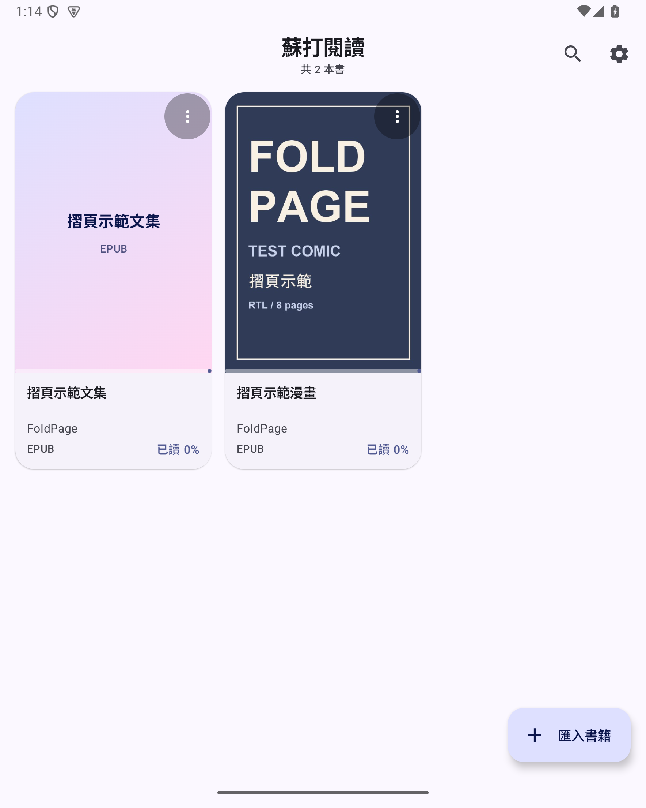
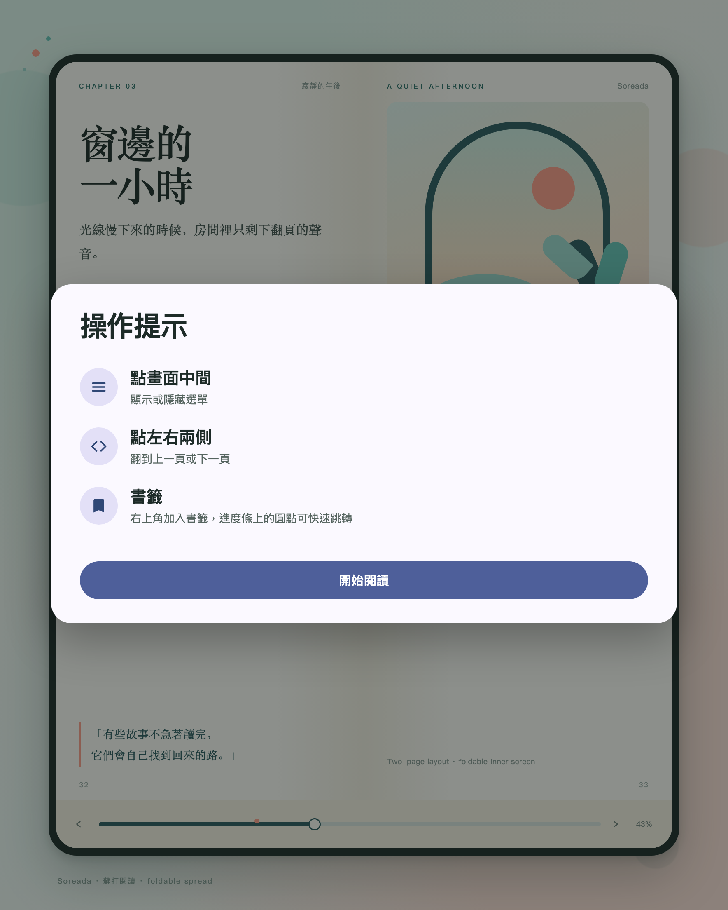
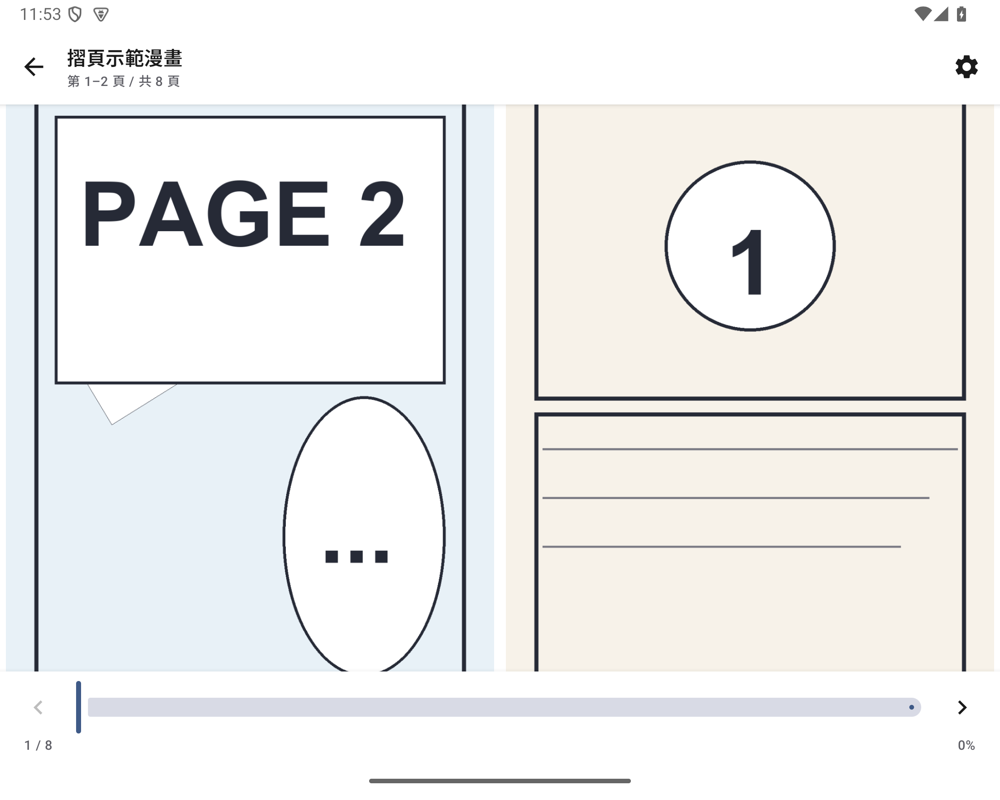
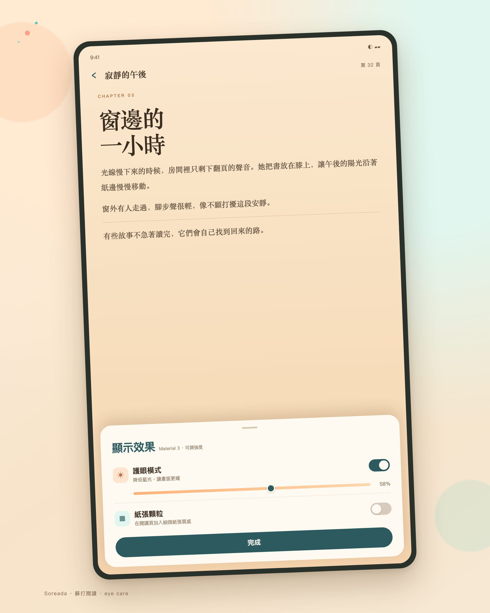
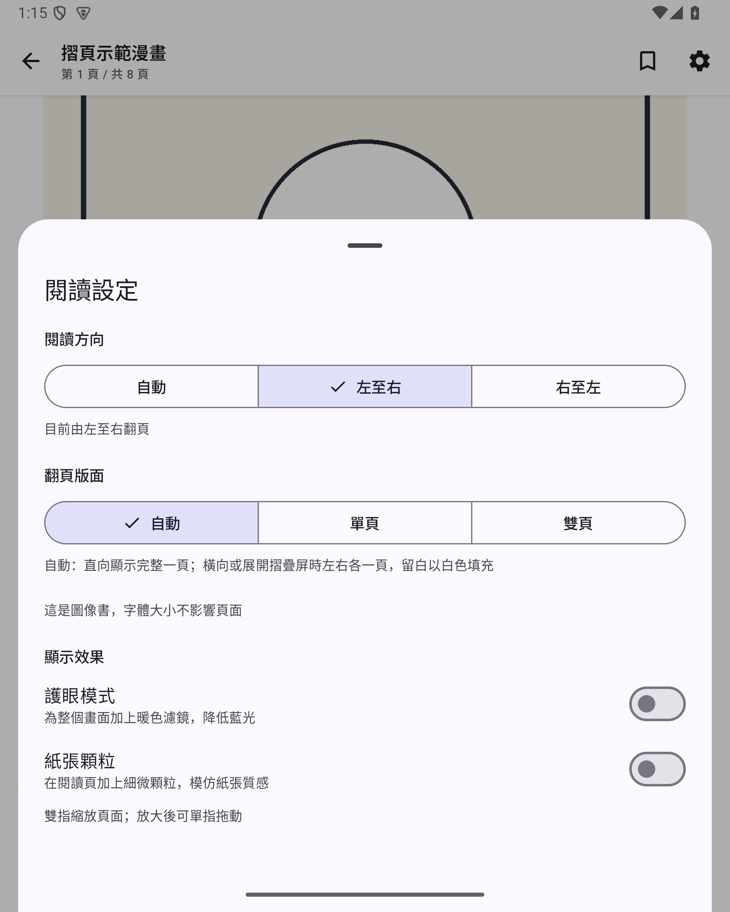
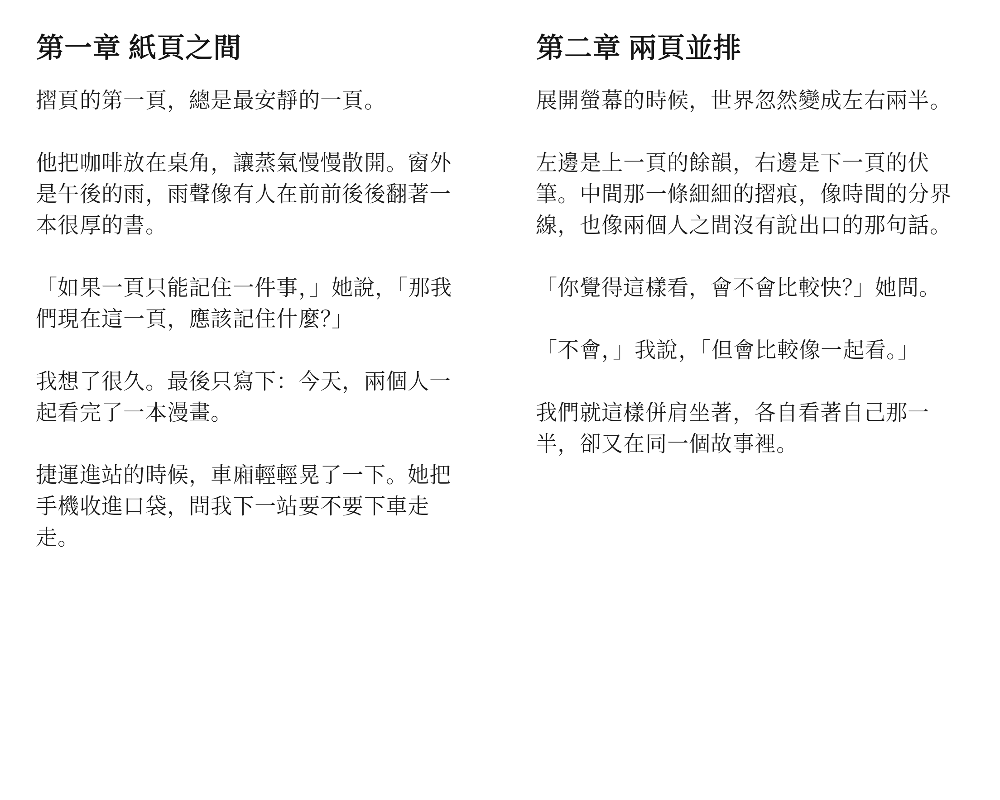

<p align="center">
  
</p>

<h1 align="center">Soreada · 蘇打閱讀</h1>

<p align="center">
  <strong>A free, open-source, modern EPUB/TXT reader for Android foldables and tablets.</strong><br />
  <strong>免費、開源、現代的 EPUB／TXT 閱讀器，支援摺疊屏與平板寬屏</strong><br />
  <strong>免费、开源、现代的 EPUB／TXT 阅读器，支持折叠屏与平板宽屏</strong>
</p>

<p align="center">
  
  
  
  
  
</p>

<p align="center">
  <a href="https://amamiya-kanae.github.io/Soreada/"><strong>官方網站 / Website</strong></a> ·
  <a href="https://github.com/Amamiya-Kanae/Soreada/releases/latest">下載 APK</a> ·
  <a href="#繁體中文">繁體中文</a> ·
  <a href="#简体中文">简体中文</a> ·
  <a href="#english">English</a>
</p>

---

## Screenshots

| Library / 書庫 | First-run tips / 首次提示 | Foldable spread / 摺疊屏雙頁 |
| --- | --- | --- |
|  |  |  |

| Eye care / 護眼模式 | Reader settings / 閱讀設定 | Text spread / 文字雙頁 |
| --- | --- | --- |
|  |  |  |

---

<a id="繁體中文"></a>
## 繁體中文

### 簡介

Soreada（蘇打閱讀）是一個免費、開源的 Android EPUB／TXT 閱讀器，為漫畫與文字閱讀而做。介面使用 Material 3，支援繁體中文、简体中文與 English。

### 功能

- **漫畫 EPUB**：支援 EPUB 2／3 的圖像 spine，直接顯示圖片頁，也支援 XHTML 包一張圖的常見做法。
- **文字閱讀**：TXT 自動辨識 UTF-8／UTF-16／GB18030；EPUB 文字書保留章節，支援字級調整與重新分頁。
- **顯示效果**：護眼模式（暖色濾鏡，可調強度）、紙張顆粒（閱讀頁專用）、淺色／深色／跟隨系統。
- **雙指縮放**：漫畫頁支援 1×–4×，放大後可單指拖動；縮放時暫停翻頁，換頁自動還原。
- **書籤**：每本書可加多個書籤，進度條上方顯示圓點，點圓點直接跳頁；文字書以字元位置保存。
- **書庫**：匯入、封面、閱讀進度、最近閱讀、書名／作者搜尋。
- **首次開書提示**：第一次打開書籍時提示點中間開選單、點兩側翻頁、書籤與進度條跳轉，只出現一次。
- **三語介面**：繁體中文、简体中文、English 即時切換。

### 摺疊屏與平板寬屏

Soreada 依視窗寬高判斷版面，不綁定特定機型：

- **內屏直向／手機**：完整一頁，不足處以白色留白。
- **內屏橫向／平板寬屏**：左右並排兩頁，適合漫畫跨頁與長篇文字。
- **外屏／窄視窗**：維持單頁，不會硬塞兩頁。
- **展開、摺疊、旋轉**：保留目前頁；文字會依新寬度重新排版。
- **RTL 漫畫**：右至左翻頁時，第一頁在右側；仍可手動切換為左至右。

### 開發者想法

我想做一個免費、好用、設計現代的開源閱讀器。

市面上的閱讀器，有些功能很強但介面停留在十年前；有些設計漂亮，卻把基本的閱讀體驗放在訂閱或廣告後面。Soreada 先從漫畫與文字閱讀出發，把翻頁、排版、摺疊屏與平板寬屏這些基本事情做好，再慢慢加功能。

它會保持免費與開源，不會加入訂閱制。如果你有想支援的格式或使用場景，歡迎開 Issue。

### 下載與安裝

- APK 放在 [GitHub Releases](https://github.com/Amamiya-Kanae/Soreada/releases/latest)。
- Android 8.0（API 26）以上。
- Package：`com.kanae.soreada`（0.3.0 起；舊版 `com.kanae.foldpage` 可並存，但書庫不互通，需重新匯入）。

---

<a id="简体中文"></a>
## 简体中文

### 简介

Soreada（苏打阅读）是一个免费、开源的 Android EPUB／TXT 阅读器，为漫画与文字阅读而做。界面使用 Material 3，支持繁体中文、简体中文与 English。

### 功能

- **漫画 EPUB**：支持 EPUB 2／3 的图像 spine，直接显示图片页，也支持 XHTML 包一张图的常见做法。
- **文字阅读**：TXT 自动识别 UTF-8／UTF-16／GB18030；EPUB 文字书保留章节，支持字号调整与重新分页。
- **显示效果**：护眼模式（暖色滤镜，可调强度）、纸张颗粒（阅读页专用）、浅色／深色／跟随系统。
- **双指缩放**：漫画页支持 1×–4×，放大后可单指拖动；缩放时暂停翻页，换页自动还原。
- **书签**：每本书可添加多个书签，进度条上方显示圆点，点圆点直接跳页；文字书以字符位置保存。
- **书库**：导入、封面、阅读进度、最近阅读、书名／作者搜索。
- **首次开书提示**：第一次打开书籍时提示点中间开菜单、点两侧翻页、书签与进度条跳转，只出现一次。
- **三语界面**：繁体中文、简体中文、English 即时切换。

### 折叠屏与平板宽屏

Soreada 根据窗口宽高判断版面，不绑定特定机型：

- **内屏竖向／手机**：完整一页，不足处用白色留白。
- **内屏横向／平板宽屏**：左右并排两页，适合漫画跨页与长篇文字。
- **外屏／窄窗口**：保持单页，不会硬塞两页。
- **展开、折叠、旋转**：保留当前页；文字会按新宽度重新排版。
- **RTL 漫画**：从右至左翻页时，第一页在右侧；仍可手动切换为从左至右。

### 开发者想法

我想做一个免费、好用、设计现代的开源阅读器。

市面上的阅读器，有些功能很强但界面停留在十年前；有些设计漂亮，却把基本的阅读体验放在订阅或广告后面。Soreada 先从漫画与文字阅读出发，把翻页、排版、折叠屏与平板宽屏这些基本事情做好，再慢慢加功能。

它会保持免费与开源，不会加入订阅制。如果你有想支持的格式或使用场景，欢迎开 Issue。

### 下载与安装

- APK 放在 [GitHub Releases](https://github.com/Amamiya-Kanae/Soreada/releases/latest)。
- Android 8.0（API 26）以上。
- Package：`com.kanae.soreada`（0.3.0 起；旧版 `com.kanae.foldpage` 可共存，但书库不互通，需要重新导入）。

---

<a id="english"></a>
## English

### About

Soreada is a free, open-source EPUB/TXT reader for Android, built for comics and long-form text. It uses Material 3 and ships in Traditional Chinese, Simplified Chinese, and English.

### Features

- **Comic EPUB**: Supports EPUB 2/3 image spines, including XHTML pages that wrap a single image.
- **Text reading**: Detects UTF-8, UTF-16, and GB18030 TXT files; keeps EPUB chapters and supports font sizing with reflow.
- **Display**: Eye care (warm filter with adjustable strength), paper grain on reading pages, light/dark/system theme.
- **Pinch zoom**: 1×–4× on comic pages, with one-finger pan while zoomed; paging pauses during zoom and resets on page change.
- **Bookmarks**: Multiple bookmarks per book, shown as dots above the progress bar; tap a dot to jump. Text bookmarks store character offsets.
- **Library**: Import, covers, reading progress, recent order, and title/author search.
- **First-run tips**: On the first book opened, a one-time card explains the middle tap, side taps, bookmarks, and progress-bar jumps.
- **Three languages**: Switch between Traditional Chinese, Simplified Chinese, and English at runtime.

### Foldables and wide tablets

Soreada chooses its layout from the current window size, not a device model:

- **Inner screen portrait / phone**: One full page, with white letterboxing.
- **Inner screen landscape / wide tablet**: Two pages side by side, for spreads and long-form text.
- **Cover screen / narrow window**: Stays single-page instead of squeezing two pages in.
- **Unfold, fold, rotate**: Keeps the current page; text reflows to the new width.
- **RTL comics**: In right-to-left mode the first page sits on the right; left-to-right remains available.

### Why I built this

I wanted a free, open-source reader that feels modern.

Many readers are powerful but look dated; others look great but hide basic reading behind subscriptions or ads. Soreada starts with comics and text, gets paging, typography, foldables, and wide tablets right first, then grows from there.

It will stay free and open source, with no subscription. If there is a format or use case you want supported, open an issue.

### Download

- APK: [GitHub Releases](https://github.com/Amamiya-Kanae/Soreada/releases/latest).
- Android 8.0 (API 26) or newer.
- Package: `com.kanae.soreada` (since 0.3.0; the older `com.kanae.foldpage` app can coexist, but libraries are separate and books must be re-imported).

---

## Build / 建置

Requirements: JDK 17, Android SDK 35, Gradle 8.9 (the wrapper is included).

```bash
git clone https://github.com/Amamiya-Kanae/Soreada.git
cd Soreada
./gradlew assembleDebug
```

For a release build, use your own signing key; the maintainer's keystore is not in this repository. Android Studio can also open the project directly.

## Current scope / 目前範圍

Android only. DRM-protected EPUB, CBZ/CBR, PDF, vertical writing, and iOS are not supported yet.

## License / 授權

MIT. See [LICENSE](LICENSE).

## Developer

[Amamiya-Kanae](https://github.com/Amamiya-Kanae) · [Issues](https://github.com/Amamiya-Kanae/Soreada/issues)
